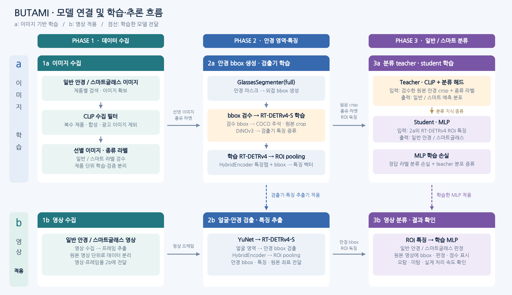

# BUTAMI

일반 안경 착용·미착용·스마트글래스 착용 사람 이미지와 영상을 수집하고 얼굴·안경 bbox를 생성한다. 안경 영역의 특징으로 일반 안경과 스마트글래스를 분류하는 프로젝트.

기준 검출 모델: [AIMIA-EAI/RT-DETRv4](https://github.com/AIMIA-EAI/RT-DETRv4)

## 전체 흐름



- **현재 이미지 경로:** `1a → 2a → 3a` — 사람 이미지 수집 → 얼굴·안경 bbox·확률·얼굴 선택 → CLIP 특징·3-class MLP 학습·평가.
- **영상 경로:** `1b → 2b → 3b` — 영상 수집 → 얼굴·안경 검출·특징 추출 → 일반/스마트 분류 결과 표시.
- **모델 전달:** `2a → 2b`는 학습한 검출기·특징 추출기를, `3a → 3b`는 학습한 MLP를 전달한다.

## 폴더 구조

```text
BUTAMI/
├── code/
│   ├── phase1a_images/
│   │   ├── image_crawl.py
│   │   └── recollect_images.py
│   ├── phase1b_videos/
│   ├── phase2a_extract/
│   │   ├── extract_bbox.py
│   │   └── review_bbox.ipynb
│   ├── phase2b_video_check/
│   ├── phase3a_train/
│   │   ├── train_mlp.py
│   │   └── run_mlp.ipynb
│   └── phase3b_video_check/
├── data/
│   ├── images/
│   │   ├── no_glasses/
│   │   ├── regular_glasses/
│   │   └── smart_glasses/
│   ├── archive/
│   ├── videos/
│   └── annotations/
│       └── face_glasses.json
├── results/
│   ├── phase1a_images/
│   │   ├── metadata.csv
│   │   └── results.md
│   ├── phase1b_videos/
│   ├── phase2a_extract/
│   │   └── results.md
│   ├── phase2b_video_check/
│   ├── phase3a_train/
│   │   ├── results.md
│   │   ├── metrics.json
│   │   ├── predictions.csv
│   │   ├── excluded_images.csv
│   │   ├── confusion_matrix.png
│   │   └── misclassified_001.png
│   └── phase3b_video_check/
├── ckpt/
│   ├── pretrained/
│   │   ├── clip/
│   │   ├── face_detection_yunet_2023mar.onnx
│   │   ├── segmentation_full_lraspp_mobilenet_v3_large.pth
│   │   └── torch/checkpoints/
│   │       └── classification_anyglasses_shufflenet_v2_x1_0.pth
│   ├── phase2a_extract/
│   └── phase3a_train/
│       └── clip_mlp_3class.pt
├── third_party/
│   ├── glasses-detector/
│   ├── RT-DETRv4/
│   └── dinov3/
└── examples/
    └── temp.py
```

| 폴더 | 관리 대상 |
| --- | --- |
| `code/` | 단계별 코드 |
| `data/` | 원본 이미지·영상, 종류 라벨·bbox 주석 |
| `results/` | 단계별 마스크·crop·특징·영상·평가와 작업 흐름 기록 |
| `ckpt/` | 사전학습 가중치와 학습한 체크포인트 |
| `third_party/` | 외부 소스와 원본 라이선스 |
| `examples/` | 참고 예시 |

`code/<단계>/`와 `results/<단계>/`는 1:1로 대응한다. 원본은 `data/`, 가중치는 `ckpt/`에 저장한다. 각 단계의 `results.md`에는 입력부터 출력까지의 작업 흐름을 기록한다.

## Phase 1. 데이터 수집

### 1a. 안경 미착용 / 일반 안경 착용 / 스마트글래스 착용 이미지

**검색 이미지 → CLIP 사람 이미지 선별 → 클래스별 500장 저장·검수 → 2a**

- `no_glasses`, `regular_glasses`, `smart_glasses` 세 종류의 사람 이미지를 각 500장, 총 1,500장 목표로 수집한다.
- CLIP으로 얼굴이 보이는 실제 인물 사진을 선별한다. 제품 단독 사진·여러 사람·콜라주·광고·부분 사진·그림·CG 인물·얼굴 지움 편집·착용자 없는 1인칭 장면도 설명 후보로 비교한다.
- 동일·유사 중복을 제거하고 출처·검색어·클래스·CLIP 점수를 기록한다.
- 한국어 검색어를 먼저 탐색한 뒤 영어 검색어를 탐색한다. 검색어는 미착용 24개·일반 안경 착용 28개·스마트글래스 착용 40개, 총 92개다.
- 스마트글래스는 한국어·영어 제품명과 착용샷·착용 후기 검색어를 함께 사용하고, 실제 종류는 출처·제품 정보로 검수한다.
- 다운로드 8개 스레드, CLIP 최대 32장 배치, 텍스트 특징 재사용으로 처리한다. 설정은 파일 상단에서 수정한다.
- 사람 이미지 수집 기록에는 `collection=people`을 저장한다. 기존 제품 이미지·CSV는 별도로 보관한 뒤 실행한다.
- 같은 인물·제품의 학습·검증·시험 분할은 검수 과정에서 관리한다.

**새 수집:** `code/phase1a_images/recollect_images.py` — 기존 이미지·수집 CSV·bbox JSON을 `data/archive/people_<실행시각>/`에 백업한 뒤 처음부터 수집.

**이어받기:** `code/phase1a_images/image_crawl.py`

**원본:** `data/images/no_glasses/`, `data/images/regular_glasses/`, `data/images/smart_glasses/`
**기록:** `results/phase1a_images/results.md`, `results/phase1a_images/metadata.csv`

### 1b. 일반 안경 / 스마트글래스 영상

**영상 수집 → 프레임 추출 → 2b**

- 일반 안경·스마트글래스 착용 영상과 비교용 미착용 영상을 확보한다.
- 고개 회전·거리·가림·조명 변화가 포함된 장면을 수집한다.
- 일정 간격으로 프레임을 추출하고 원본 영상·시각·라벨을 기록한다.
- 같은 원본 영상의 프레임은 동일한 데이터 분할에 배정한다.

**원본:** `data/videos/`  
**코드 / 결과:** `code/phase1b_videos/` ↔ `results/phase1b_videos/`

## Phase 2. 안경 영역·특징 추출

### 2a. 이미지 얼굴·안경 bbox 생성·검출기 학습·특징 추출

**1a 사람 이미지 → YuNet 얼굴 bbox → 얼굴 주변 GlassesSegmenter → 원본 좌표 COCO JSON**

현재 `code/phase2a_extract/extract_bbox.py`의 처리 범위:

1. 세 종류 폴더의 JPEG를 읽고 **YuNet**으로 얼굴 bbox를 검출한다. 기본 임계값은 0.5이고 얼굴별 탐지 점수를 저장한다. 점수 0.5 초과·면적 1% 이상인 후보가 하나일 때 주대상 얼굴 후보를 자동 선택한다. 여러 후보·작은 얼굴만 존재·미검출 이미지는 검수 대상으로 남긴다.
2. 얼굴 주변을 1.8배 확장해 **anyglasses-medium 분류기**로 안경 착용 확률을 계산하고 **full-medium 분할기**로 안경 마스크를 계산한다. 동일한 공식 가중치를 torchvision 모델에 직접 로드해 Python 3.10 이상에서 실행한다.
3. 안경 착용 확률 0.5 미만의 안경 bbox와 빈 마스크를 제외하고, 남은 안경 bbox를 원본 좌표로 복원해 저장한다.
4. 모든 이미지를 **`data/annotations/face_glasses.json`**에 기록한다. `images`의 `selected_face_id`와 `selection_status`로 얼굴 선택·검수 상태를 전달한다. 얼굴 미검출 이미지도 포함한다.
5. COCO `images / annotations / categories` 구조를 사용한다. 카테고리는 `1=face`, `2=glasses`, bbox는 원본 픽셀 기준 `[x, y, width, height]`다. 얼굴의 `score`는 YuNet 점수, `glasses_probability`는 안경 착용 확률이다. 얼굴의 `glasses_status`는 `below_threshold`, `empty_mask`, `detected`다. 안경의 `score`는 안경 착용 확률이며 `face_id`로 해당 얼굴 주석을 연결한다. 파일 경로는 `data/images/` 기준이다.
6. 최대 32개 얼굴 crop을 배치 처리하고 GPU에서는 bbox 네 좌표와 착용 확률만 배치당 한 번 CPU로 가져온다. crop·마스크는 메모리에서 사용한다.

후속 2a 학습·특징 추출:

- 자동 bbox를 검수·수정하고 **`glasses` 주석**으로 RT-DETRv4-S 1-class 검출기를 학습한다.
- 검수 bbox로 원본 안경 crop을 생성해 안경다리·렌즈·카메라 등 원본 픽셀을 보존한다.
- DINOv3의 대응 특징과 RT-DETRv4 특징을 정렬해 검출 학습에 특징 증류 손실을 결합한다.
- HybridEncoder 특징맵과 안경 bbox에 ROI pooling을 적용해 고정 길이 특징 벡터를 추출한다.

**현재 3a 전달:** 선택된 얼굴 ID·bbox·점수·안경 확률·검출 상태가 포함된 COCO JSON.

**후속 3a 전달:** 원본 안경 crop, 종류 라벨, ROI 특징 벡터.
**2b 전달:** 학습한 RT-DETRv4 검출기와 동일한 ROI 특징 추출 구성.  
**코드:** `code/phase2a_extract/extract_bbox.py`

**bbox 주석:** `data/annotations/face_glasses.json`

**작업 기록:** `results/phase2a_extract/results.md`
**학습 체크포인트:** `ckpt/phase2a_extract/`

### 2b. 영상 얼굴·안경 검출·특징 추출

**1b 프레임 → YuNet → RT-DETRv4 → ROI pooling → 3b**

- **YuNet**으로 영상 속 얼굴 영역을 찾는다.
- 얼굴 주변 영역에 **2a에서 학습한 RT-DETRv4**를 적용해 안경 bbox를 검출한다.
- 동일한 HybridEncoder·ROI pooling 구성으로 안경 특징을 추출한다.
- 얼굴 crop 기준 bbox를 원본 프레임 좌표로 변환하고 프레임 ID·시각과 함께 기록한다.
- 안경 bbox와 특징 벡터를 3b에 전달하고, 검출 위치·누락을 확인한다.

**코드 / 결과:** `code/phase2b_video_check/` ↔ `results/phase2b_video_check/`

## Phase 3. 미착용 / 일반 안경 / 스마트글래스 분류

### 3a. 3-class MLP 학습·평가

**2a의 선택된 얼굴 → 얼굴 주변 crop → 고정 CLIP 특징 → 3-class MLP → 원래 예측·검출 상태 대조**

현재 `code/phase3a_train/train_mlp.py`의 처리 범위:

- `selected_face_id`가 지정되고 탐지 점수 0.5 초과인 얼굴 하나를 이미지별로 사용한다. 얼굴 선택 검수 대상은 제외 이유를 CSV로 기록한다.
- 원본 폴더의 미착용·일반 안경·스마트글래스 라벨을 그대로 사용한다.
- 얼굴 주변 1.8배 crop의 CLIP 특징을 한 번 추출하고 `feature_dim → 128 → 3` MLP를 학습한다.
- 클래스별 이미지 단위 80:20 분리, seed 42, 100 epoch를 기본으로 사용한다.
- MLP의 원래 세 클래스 softmax로 전체 테스트 정확도와 혼동행렬을 계산한다.
- 안경 착용 확률과 MLP의 착용 여부가 충돌하면 원래 예측·확률을 보존하고 `final_class=review`를 기록한다. 높은 착용 확률에서 bbox가 누락된 경우도 별도 집계한다.
- 오분류 그림에는 선택된 얼굴과 해당 안경 bbox·점수, 원래 MLP 예측·확률, 최종 상태를 함께 표시한다.

**코드:** `code/phase3a_train/train_mlp.py`

**결과:** `results/phase3a_train/`의 `metrics.json`, `predictions.csv`, `excluded_images.csv`, `confusion_matrix.png`, `misclassified_*.png`

**체크포인트:** `ckpt/phase3a_train/clip_mlp_3class.pt`

#### 후속 계획: 일반/스마트 teacher·student 학습과 증류

**2a 원본 crop → CLIP + 분류 헤드 → teacher 예측 분포**  
**2a ROI 특징 → MLP → student 예측**

- **Teacher:** CLIP 이미지 인코더에 일반/스마트 분류 헤드를 연결하고, 검수한 원본 crop과 종류 라벨로 학습한다.
- **Student:** 2a의 RT-DETRv4 ROI 특징을 입력으로 받는 **MLP 2-class 분류기**를 학습한다.
- 먼저 RT-DETRv4 검출기·encoder를 고정하고 MLP를 학습한다.
- Student의 정답 라벨 분류 손실에 teacher의 두 클래스 예측 분포에 대한 증류 손실을 결합한다.
- Teacher와 student에는 동일한 안경 인스턴스에 대응하는 crop·ROI 특징을 입력한다.
- 검증 데이터로 분류 임계값을 결정하고, 학습 기종·미학습 기종을 구분해 평가한다.

**3b 전달:** 학습한 MLP, 클래스 순서, 특징 전처리와 판정 임계값.  
**코드 / 결과:** `code/phase3a_train/` ↔ `results/phase3a_train/`  
**체크포인트:** `ckpt/phase3a_train/`  
**평가:** 혼동행렬, precision·recall, 일반 안경 오탐률, 기종별 성능.

### 3b. 영상 분류·결과 확인

**2b 안경 bbox·ROI 특징 → 3a MLP → 일반/스마트 판정 → 원본 영상 표시**

- 2b에서 전달한 안경 특징을 **3a에서 학습한 MLP**에 입력한다.
- 원본 영상 좌표의 bbox에 일반/스마트 판정과 분류 점수를 표시한다.
- 동일 인물의 연속 예측을 모아 결과를 안정화한다.
- 검출 상태와 분류 상태를 구분하고 불확실한 장면은 판별 보류로 처리한다.
- 영상별 오탐·미탐·실제 처리 FPS를 확인한다.

**코드 / 결과:** `code/phase3b_video_check/` ↔ `results/phase3b_video_check/`

## 모델별 연결

| 모델 | 단계 | 입력 → 출력·전달 대상 |
| --- | --- | --- |
| CLIP 수집 필터 | 1a | 검색 이미지 → 선별 이미지 → 2a |
| GlassesClassifier(`anyglasses`) 가중치 | 2a | 얼굴 주변 영역 → 안경 착용 확률 → bbox 저장 여부 |
| GlassesSegmenter(`full`) 가중치 | 2a | 얼굴 주변 영역 → 안경 마스크 → 원본 좌표 bbox·COCO 주석 |
| DINOv3 | 2a | 동일 이미지 → 교사 특징 → RT-DETRv4 특징 증류 |
| RT-DETRv4-S | 2a → 2b | 이미지·프레임 → 안경 bbox·HybridEncoder 특징맵 |
| ROI pooling | 2a → 3a / 2b → 3b | 특징맵 + bbox → 안경별 고정 길이 특징 |
| YuNet | 2a / 2b | 사람 이미지·영상 프레임 → 얼굴 bbox·주변 영역 |
| CLIP + MLP 3-class | 현재 3a | 선택된 얼굴 주변 crop → 세 클래스 확률·판정 충돌 기록 |
| CLIP + 분류 헤드 | 후속 3a | 원본 안경 crop → 일반/스마트 예측 분포 → MLP 증류 |
| MLP | 3a → 3b | ROI 특징 → 일반/스마트 점수·판정 |

CLIP의 이미지 선별과 종류 분류는 각각 별도의 역할이다. DINOv3의 특징 증류는 2a 검출 학습에, CLIP teacher의 분류 증류는 3a 분류 학습에 연결한다.

## 체크포인트 관리

| 위치 | 내용 |
| --- | --- |
| `ckpt/pretrained/` | GlassesSegmenter·YuNet·CLIP·RT-DETRv4·DINOv3 사전학습 가중치 |
| `ckpt/phase2a_extract/` | 학습한 안경 검출기와 특징 정렬 모듈 |
| `ckpt/phase3a_train/` | 현재 `clip_mlp_3class.pt`, 후속 CLIP teacher·MLP student |

YuNet은 `ckpt/pretrained/face_detection_yunet_2023mar.onnx`, 안경 분할 가중치는 `ckpt/pretrained/segmentation_full_lraspp_mobilenet_v3_large.pth`, CLIP 캐시는 `ckpt/pretrained/clip/`에 둔다. 안경 착용 분류기는 `ckpt/pretrained/torch/checkpoints/classification_anyglasses_shufflenet_v2_x1_0.pth`를 사용한다. 추출기는 없는 YuNet·안경 분류·분할 가중치를 공식 배포 URL에서 다운로드하고 로컬 파일을 재사용한다.

## 실행 순서와 확인

Python 3.12 환경에서 수집 코드에 필요한 `ddgs`, `requests`, `Pillow`, `torch`, `transformers`, `ImageHash`를 준비한다. 추출은 Python 3.10 이상에서 `opencv-python-headless`, `numpy`, `Pillow`, `torch`, `torchvision`으로 실행한다.

1. IDE에서 `code/phase1a_images/recollect_images.py` 실행 → 기존 이미지·CSV·bbox JSON 백업 → 새 사람 이미지·CSV 수집. 중단 후 이어받기는 `image_crawl.py`를 실행한다.
2. 이미지 종류·착용 상태 검수.
3. IDE에서 `code/phase2a_extract/extract_bbox.py` 실행 → 얼굴 점수·안경 착용 확률을 포함한 COCO JSON 저장. 기존 JSON도 다시 추출해 갱신한다.
4. `code/phase2a_extract/review_bbox.ipynb`에서 원본 라벨과 주대상 얼굴을 검수한다. 검수한 얼굴은 `selected_face_id`에 지정하고, 검수 대기 이미지는 `null`을 유지한다.
5. `code/phase3a_train/train_mlp.py` 또는 같은 폴더의 `run_mlp.ipynb` 실행 → 3-class MLP·원래 예측 성능·오분류 박스 그림·충돌 및 누락 기록 저장.

`tests/test_image_pipeline.py`는 외부 검색·모델을 대체해 세 클래스 수집·중복 제거·이어받기, bbox 원본 좌표 복원, 빈 마스크, 여러 얼굴, 주대상 얼굴 선택·검수, COCO 저장, 학습 라벨·원래 예측 보존, 충돌 기록, 오분류 박스 표시를 검사한다. 저장소 루트에서 `python -m unittest discover -s tests -v`로 실행한다. 실제 수집 수량과 모델 추론 품질은 실행 환경에서 확인한다.

## 원본 출처

- [AIMIA-EAI/RT-DETRv4](https://github.com/AIMIA-EAI/RT-DETRv4)
- [facebookresearch/dinov3](https://github.com/facebookresearch/dinov3)
- [OpenAI CLIP](https://github.com/openai/CLIP)
- [OpenCV Zoo YuNet](https://github.com/opencv/opencv_zoo/tree/main/models/face_detection_yunet)
- [mantasu/glasses-detector](https://github.com/mantasu/glasses-detector): 포함된 [MIT License](third_party/glasses-detector/LICENSE) 및 저작권 표시 유지.

